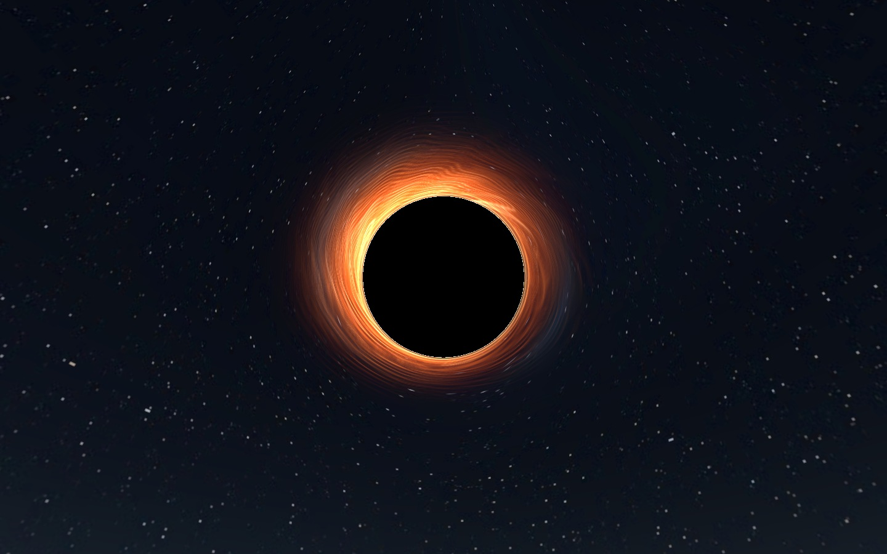

# liminal uwu

The signs under the pink **uwu** streetlights give you the next stop. Pick a passage or take a chance on the **Any platform** ticket machine. Twelve walking passages connect the nine main districts. Two side wings grow smaller until you have to turn back.

## Catch the Aperture Express

Follow **Spiral Line** north from the exchange. At Platform 01, press **Call train down** if the train is overhead. It finishes the climb and can leave the summit early. When the doors open, walk aboard and interact with a window seat. Three carriages carry up to six seated passengers. The train climbs two turns through a ribbed tunnel, pauses facing the black hole and reverses down the same track. Exiting a seat puts you back on the platform. The ride and seat positions match on PC and Quest.

| Inside the train | At the aperture |
| --- | --- |
|  |  |

Both views were captured in Unity. [On the helix](Preview/On%20the%20helix.jpg) · [The photon ring from the observatory](Preview/Photon%20ring.jpg)

## Around the exchange

**Hanging Orchard** leads through a procession of torii to a five-storey pagoda. A broadcast tower rises behind the shrine. The beds of the **Diminishing Baths** catch light from overhead fixtures. In **Night Reception**, the desks, telephones, doorways and ceiling shrink together. The observatory has a leaning Eiffel Tower. A stretched jet hangs over the air terminal. The train platforms, art hall, service wing and rain courts each have their own quieter soundscape.

| Hanging Orchard | Diminishing Baths |
| --- | --- |
|  |  |
| **Night Reception** | **The Embankment broadcast** |
|  |  |

The exchange kiosk, art gallery and archive windows share a 24-second city broadcast. The buildings lift off the waterfront, spiral into the shadow and disappear. The last image holds before the screen goes black for two seconds and starts over. [Watch the original film loop](Preview/Embankment%20transmission.webp)

## Gravity travel

The ceiling and wall terminals in **Ceiling Ward** open into full-size versions of the archive rotated through 180° and 90°. Your feet meet the former ceiling or wall while your headset horizon stays level. Other visitors can walk beside you. Four return terminals and two reversible arches connect the archive, shrine garden and tower court.

The **Six direction ride** changes player gravity and carries you up, right, forward, down, left and back. Jump to leave early. Completing or exiting the ride restores your previous gravity.

## Open in Creator Companion

Use Unity **2022.3.22f1** and the pinned Worlds SDK. Choose **Open Project** in Creator Companion. When adding a checkout, select the folder containing **Assets**, **Packages** and **ProjectSettings**, then resolve the project packages. The authored scenes are saved under **Assets → Stillwater → Scenes**. Pick **liminal uwu - PC** for Windows and **liminal uwu - Quest** for Android.

The PC sky bends the star field around an absolutely black circle. Moving gas filaments, bright knots and dark dust lanes surround its thin luminous rim. An offline ray lookup supplies the lensing, with four gas layers and a secondary ring sampled in the shader. Wet floors have sharper puddle reflections between rough stone patches, ripple detail and baked fixture lighting. Gentle blue haze gives the upper spiral more depth. Scanned surfaces carry colour, normals, roughness and occlusion. Quest keeps the same sky silhouette, train seats, timing, gravity destinations and collision geometry with a two-layer sky, simplified meshes, smaller textures and a cheaper floor finish.

## Checks and publishing

GitHub samples the collision geometry in both scenes, checks the train and its doors across a full circuit, compares network IDs and inspects the black-hole pixels in a captured room reflection. The route diagrams are development artifacts. The release world contains local signs. [Hosted checks](https://github.com/WeepingAngeIs/liminal-uwu-pc-side-high-quility/actions)

The licensed export workflow bakes occlusion on the runner, exports Windows and Android bundles, checks the Quest download size and exercises the gravity ride in ClientSim. To publish, use the same VRChat world blueprint ID for both uploads. [Remote build setup](Tools/CI/README.md) · [VRChat cross-platform publishing](https://creators.vrchat.com/platforms/android/cross-platform-setup/)

## References and materials

The supplied ORGANISM recording and screenshots informed the transition from narrow, tiled passages into large open rooms. British Home informed the decision to spend texture detail at arm's length and capture stationary lighting and reflections during authoring. The cache inspection and the creator's account are documented separately. [British Home measurements and sources](Tools/CI/British-Home-reference.md)

The architecture, train, city broadcast, wall prints and soundscapes were authored for **liminal uwu**. The PC gas shading adapts equations from [tantaneity's MIT black-hole shader](https://github.com/tantaneity/urp-black-hole) for this Built-in project; the wet finish adapts parts of [Mochie's MIT shaders](https://github.com/MochiesCode/Mochies-Unity-Shaders). Their license notices are retained in `Assets/Stillwater/ThirdParty`.

Scanned surface maps come from Poly Haven under CC0. [Blue Floor Tiles 01](https://polyhaven.com/a/blue_floor_tiles_01) · [Brick Wall 005](https://polyhaven.com/a/brick_wall_005) · [Grey Roof Tiles](https://polyhaven.com/a/grey_roof_tiles) · [Wood Plank Wall](https://polyhaven.com/a/wood_plank_wall) · [Painted Plaster Wall](https://polyhaven.com/a/painted_plaster_wall) · [Granite Tile](https://polyhaven.com/a/granite_tile) · [License](https://polyhaven.com/license)

